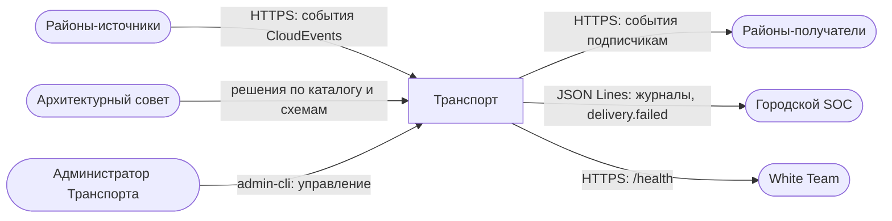
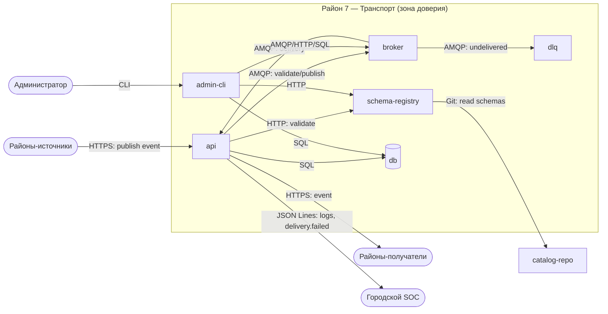

# Архитектура района __7__ — Транспорт

**Команда:** 7 · **Тимлид:** Ефремов Александр Сергеевич · **Версия:** v0 · **Дата:** 19.10.2026

## 1. Назначение
Транспорт — асинхронная шина событий города: принимает события районов в конверте CloudEvents 1.0, валидирует их по JSON Schema и доставляет подписчикам. Хранит недоставленные события в DLQ и публикует `city.transport.delivery.failed.v1` в SOC. Владеет каталогом событий и реестром JSON Schema (P8, неделя 3).

## 2. Политика безопасности
Принимать события только от сервисов районов, аутентифицированных по mTLS (с недели 4), и публиковать их только после валидации по утверждённой JSON Schema. Изменение каталога событий и схем — только через архитектурный совет со ссылкой на протокол. Все принятые, отклонённые и недоставленные события журналируются и передаются в SOC; административные функции доступны только администратору Транспорта через `admin-cli` с аудитом.

## 3. Компоненты
| Компонент (сервис Compose) | Что делает                                                | Технология     | Порт внутри района | Виден другим районам?  |
| -------------------------- | --------------------------------------------------------- | -------------- | ------------------ | ---------------------- |
| api                        | публикация и подписка на события, выдача статуса доставки | Python/FastAPI | 8080               | да                     |
| broker                     | очередь сообщений, маршрутизация, DLQ                     | RabbitMQ       | 5672               | нет                    |
| schema-registry            | хранение и валидация JSON Schema событий                  | Python         | 8081               | нет (доступ через api) |
| dlq                        | очередь недоставленных событий                            | RabbitMQ       | —                  | нет                    |
| db                         | метаданные, статусы доставки, аудит                       | PostgreSQL     | 5432               | нет                    |
| admin-cli                  | управление топиками, схемами, DLQ                         | CLI            | —                  | нет                    |
| catalog-repo               | каталог событий и JSON Schema (Git)                       | Git            | —                  | да (общий `city`)      |

## 4. Схема потоков данных (DFD)
### Уровень 0 — район как один процесс

### Уровень 1 — район раскрыт

## 5. Границы доверия

| №   | Граница             | Что по разные стороны        | Как контролируется сейчас | Как будет (неделя)            |
| --- | ------------------- | ---------------------------- | ------------------------- | ----------------------------- |
| Г1  | Районы → api        | город / район                | пока никак                | TLS (3), mTLS (4)             |
| Г2  | api → broker        | сервис / брокер              | внутренняя сеть Docker    | ACL, сетевые политики (4–5)   |
| Г3  | admin-cli → система | администратор / пользователь | пароль в `.env`           | роли, аудит, mTLS (4)         |
| Г4  | Транспорт → SOC     | район / внешний сервис       | HTTP внутри города        | TLS (3), выделенный канал (6) |
| Г5  | catalog-repo        | район / общий Git            | доступ на чтение          | защищённая ветка, ревью (3)   |

## 6. Внешние зависимости

| От кого зависим  | Что получаем                       | Что будет, если он недоступен или скомпрометирован    |
| ---------------- | ---------------------------------- | ----------------------------------------------------- |
| Паспортный стол  | сертификаты mTLS, SSO для админа   | без mTLS районы не публикуют события; админ не войдёт |
| SOC              | приём журналов и `delivery.failed` | журналы копятся локально, расследование замедляется   |
| Шлюз             | внешний вход, защита периметра     | внешний доступ к api закрыт                           |
| Районы-источники | события                            | нет входящего потока, шина простаивает                |
| White Team       | проверка `/health`                 | SLA не измеряется, но работа не блокируется           |

## 7. Соответствие соглашениям города
- [x] Имена по Р1 (`d__N__-__CODE__`, `*.__CODE__.city.lab`)
- [x] Время UTC (Р3)
- [x] Журналы JSON Lines с обязательными полями (Р4)
- [x] События в конверте CloudEvents (Р5), описаны в `contracts/events.md`
- [x] API описан в `contracts/openapi.yaml`, есть `/health` (Р6)
- [x] Секретов в Git нет (Р7)
