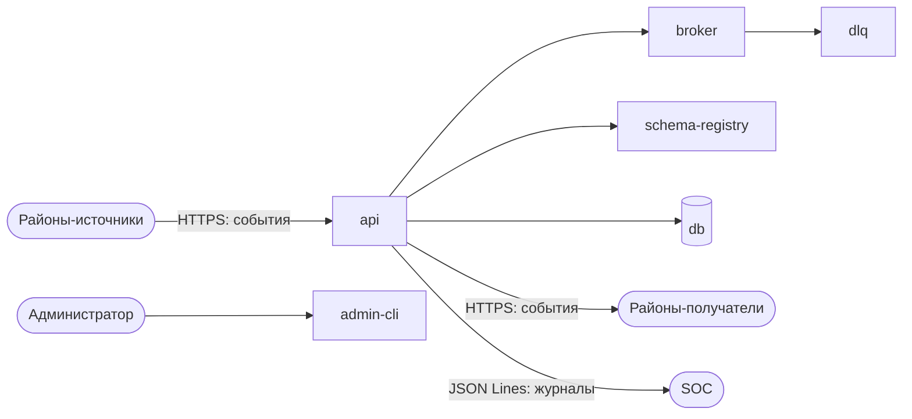

# Модель угроз района 7 — Транспорт
**Район:** 7 — Транспорт · **Команда:** 7 · **Версия:** v0 · **Дата:** 19.10.2026 · **Авторы:** команда 7

## 1. Политика безопасности района
Принимать события только от сервисов районов после mTLS (с недели 4) и публиковать только после валидации по утверждённой JSON Schema. Изменение каталога и схем — только через архитектурный совет. Все события, отказы и DLQ журналируются в SOC; администрирование — только через `admin-cli` с аудитом.

## 2. Активы — что защищаем
| Актив                               | Где хранится / проходит           | Что важнее                      | Почему ценен                             |
| ----------------------------------- | --------------------------------- | ------------------------------- | ---------------------------------------- |
| Каталог событий и JSON Schema       | `catalog-repo`, `schema-registry` | целостность                     | по ним валидируются все события города   |
| Брокер сообщений                    | `broker`                          | доступность, целостность        | без него город не обменивается событиями |
| Очередь недоставленных (DLQ)        | `dlq`, `db`                       | целостность, доступность        | потеря DLQ = потеря событий              |
| База метаданных и аудита            | `db`                              | целостность, конфиденциальность | статусы доставки, след действий          |
| Журналы Транспорта                  | stdout → SOC                      | целостность, доступность        | расследование инцидентов                 |
| Сертификаты и ключи mTLS            | `.env`, файлы                     | конфиденциальность              | подмена сервиса при утечке               |
| `admin-cli` и учётная запись админа | сервер, `.env`                    | конфиденциальность, целостность | полный контроль над шиной                |
| Репутация и доступность шины        | город                             | доступность                     | падение Транспорта останавливает город   |

## 2а. Что есть у атакующего (активы атакующего)
| Возможность атакующего                    | Откуда она у него                 | Куда может привести                   |
| ----------------------------------------- | --------------------------------- | ------------------------------------- |
| Доступ к шине как у любого района         | легальная роль сервиса района     | публикация/чтение разрешённых событий |
| Знание формата событий                    | режим white-box, открытый каталог | точная подделка конверта и `data`     |
| Учётная запись рядового сотрудника района | регистрация в Паспортном столе    | попытка повышения прав                |
| Возможность публиковать события           | API Транспорта                    | флуд, мусор, подделка источника       |
| Скомпрометированный сервис района         | уязвимость в районе               | действия от имени района              |

## 3. Участники и роли
| Роль / принципал         | Что может делать                                              | Как аутентифицируется                     |
| ------------------------ | ------------------------------------------------------------- | ----------------------------------------- |
| Житель                   | прямого доступа к Транспорту не имеет, действует через районы | SSO Паспортного стола (косвенно)          |
| Сотрудник района         | публиковать события своего района, читать разрешённые         | SSO / сервисная учётная запись (неделя 4) |
| Администратор Транспорта | управлять топиками, схемами, DLQ                              | SSO + роль admin (неделя 4)               |
| Сервис другого района    | публиковать и подписываться на разрешённые типы               | mTLS-сертификат (неделя 4)                |
| SOC                      | получать журналы и `delivery.failed`                          | сервисная учётная запись (неделя 3)       |
| White Team               | проверять `/health`                                           | без аутентификации, только health         |

## 4. Схема потоков данных (DFD)
Полная схема — в `docs/architecture.md`, раздел 4. Кратко:


## 5. Границы доверия

| Граница | Что по разные стороны | Как контролируется                   |
| ------- | --------------------- | ------------------------------------ |
| Г1      | Районы → api          | сейчас никак; TLS (3), mTLS (4)      |
| Г2      | api → broker          | внутренняя сеть; ACL (4–5)           |
| Г3      | admin-cli → система   | пароль; роли и аудит (4)             |
| Г4      | Транспорт → SOC       | HTTP; TLS (3)                        |
| Г5      | catalog-repo          | чтение; защищённая ветка и ревью (3) |

## 6. Модель нарушителя

| Противник                                        | Возможности                                 | Мотив                     | Вероятность для нас     |
| ------------------------------------------------ | ------------------------------------------- | ------------------------- | ----------------------- |
| Внешний атакующий из скомпрометированного района | публикация/чтение событий, знание формата   | исказить городские данные | высокая                 |
| Внутренний нарушитель — администратор Транспорта | менять схемы, DLQ, отключать журналы        | саботаж, выгода           | средняя                 |
| Скомпрометированный сервис района                | шлёт мусор, повторы, флуд                   | нарушить работу           | высокая                 |
| Red Team (недели 8–11)                           | целенаправленные атаки                      | проверка защиты           | средняя (по расписанию) |
| Невнимательный разработчик                       | секреты в Git, открытый порт, слабый пароль | ошибка                    | высокая                 |

## 7. Угрозы по STRIDE

|Элемент|S — подмена|T — изменение|R — отказ от авторства|I — утечка|D — отказ в обслуживании|E — повышение привилегий|
|---|---|---|---|---|---|---|
|api|T01|T03|T05|T07|T10, T13|T14|
|broker|T02|T03|T06|T09|T11|T16|
|schema-registry|—|T04|—|—|—|T15|
|dlq|—|—|—|T08|T12|—|
|db|—|—|T06|T07|T12|—|
|admin-cli|—|—|—|—|—|T14|

### Реестр угроз

|ID|Элемент DFD|STRIDE|Угроза: кто, что делает, к чему приводит|Вероятность|Ущерб|Риск|Мера (раздел 9)|
|---|---|---|---|---|---|---|---|
|T01|api|S|Скомпрометированный район публикует `city.bank.fee.paid.v1` от имени Банка; Мэрия считает пошлину оплаченной|4|5|20|M1, M2|
|T02|api|S|Атакующий шлёт поддельный `city.transport.delivery.failed.v1` в SOC, чтобы скрыть реальный сбой|3|4|12|M1, M2|
|T03|broker|T|Атакующий с доступом к брокеру меняет `data.amount` в событии оплаты|4|5|20|M2, M3|
|T04|schema-registry|T|Инсайдер или атакующий меняет JSON Schema, чтобы пропустить вредное событие|3|4|12|M4, M5|
|T05|api|R|Район отрицает отправку события: нет подписи источника|3|3|9|M2|
|T06|broker/dlq|R|Транспорт отрицает недоставку: журнал DLQ неполный|3|3|9|M6|
|T07|api/db|I|Чтение payload событий Больницы и Паспортного стола (PII)|4|5|20|M3, M7|
|T08|dlq|I|Чтение событий из DLQ без ACL|3|4|12|M3|
|T09|broker|I|Прямое подключение к брокеру и чтение всех событий|4|5|20|M3, M7|
|T10|api|D|Флуд событиями от скомпрометированного района|4|4|16|M8, M9|
|T11|broker|D|Падение брокера из-за исчерпания ресурсов|3|5|15|M9, M10|
|T12|dlq/db|D|Переполнение DLQ или диска БД|3|4|12|M6, M10|
|T13|api|D|DoS на `/health`, White Team считает SLA неверно|3|3|9|M9|
|T14|admin-cli|E|Компрометация админа Транспорта: полный контроль над шиной|3|5|15|M5, M11|
|T15|schema-registry|E|Повышение прав через изменение схемы или API реестра|2|5|10|M4, M5|
|T16|broker|E|Уязвимость брокера приводит к выполнению кода|2|5|10|M10|

## 8. Дерево атаки (для самой ценной цели)
```
Цель: исказить или остановить городские события
├── ИЛИ: подделать событие
│   └── И: получить доступ к сети города + знать формат события + обойти аутентификацию (в v0 её нет)
│       ├── скомпрометировать сервис района
│       └── украсть сертификат сервиса (после недели 4)
├── ИЛИ: изменить событие
│   └── И: получить доступ к брокеру + обойти mTLS/подпись
│       ├── прямой доступ к порту 5672
│       └── компрометация api
├── ИЛИ: остановить шину
│   ├── ИЛИ: флуд событиями
│   ├── ИЛИ: уронить брокер
│   └── ИЛИ: переполнить DLQ/диск
└── ИЛИ: прочитать события
    └── И: доступ к брокеру или DLQ + обойти ACL
        ├── подключение к брокеру
        └── чтение DLQ через api
```
Листья, закрываемые одной мерой: mTLS (M1) закрывает подделку источника; подписи (M2) — изменение; rate limiting (M8) — флуд; ACL (M3) — чтение.

## 9. Меры защиты

| Угроза             | Мера                                                                | Кто отвечает   | Статус |
| ------------------ | ------------------------------------------------------------------- | -------------- | ------ |
| T01, T02           | M1: mTLS между районами и api (неделя 4)                            | инфраструктура | план   |
| T01, T03, T05      | M2: подписи событий и anti-replay (неделя 5)                        | безопасность   | план   |
| T03, T07, T08, T09 | M3: ACL на топики и DLQ, запрет прямого доступа к брокеру (4–5)     | инфраструктура | план   |
| T04, T15           | M4: валидация схем, запрет изменения без совета (3)                 | тимлид         | план   |
| T04, T14, T15      | M5: роли и аудит `admin-cli`, защищённая ветка `catalog-repo` (3–4) | безопасность   | план   |
| T06, T12           | M6: мониторинг DLQ и бэкапы БД (5)                                  | инфраструктура | план   |
| T07, T09           | M7: минимизация payload, шифрование чувствительных событий (5–6)    | безопасность   | план   |
| T10, T13           | M8: rate limiting и квоты на район (6)                              | инфраструктура | план   |
| T10, T11, T13      | M9: сегментация сети, лимиты ресурсов, health без лишнего (6–7)     | инфраструктура | план   |
| T11, T12, T16      | M10: hardening брокера, обновления, резервирование (7)              | инфраструктура | план   |
| T14                | M11: отдельная учётная запись админа, MFA, журнал действий (4)      | безопасность   | план   |
Для риска ≥12 меры назначены: T01, T02, T03, T04, T07, T08, T09, T10, T11, T12, T14. Топ-5: T01, T03, T07, T09, T10.

## 10. Остаточные риски
Сознательно не закрываем в v0: zero-day уязвимость брокера; инсайдер-администратор с полным легальным доступом; supply chain зависимостей; PII в событиях до внедрения шифрования payload (неделя 5–6); отсутствие anti-replay до недели 5; слабая аутентификация в v0 (по условиям недели 2). Эти риски зафиксированы и переносятся в v1.

## 11. Использование LLM
Для черновика STRIDE использованы 3 модели: локальные `llama3.2:3b`, `qwen2.5:7b` и облачная DeepSeek. Приняты после проверки: T01, T03, T07, T10, T14. Отвергнуты как «выдумано»: Redis на порту 6380, ГОСТ 99999. Помечены «мимо»: общие угрозы без привязки к Транспорту. Пропущено всеми и добавлено вручную: R для журналов (T06), D для DLQ (T12), E через `admin-cli` (T14). Запись — в `docs/llm-log.md`.

## История версий

| Версия | Дата       | Что изменилось           |
| ------ | ---------- | ------------------------ |
| v0     | 19.10.2026 | первая версия (неделя 2) |
